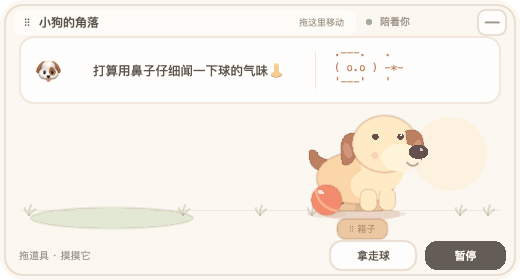
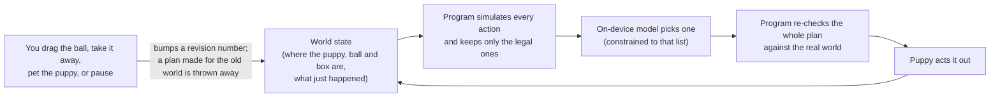
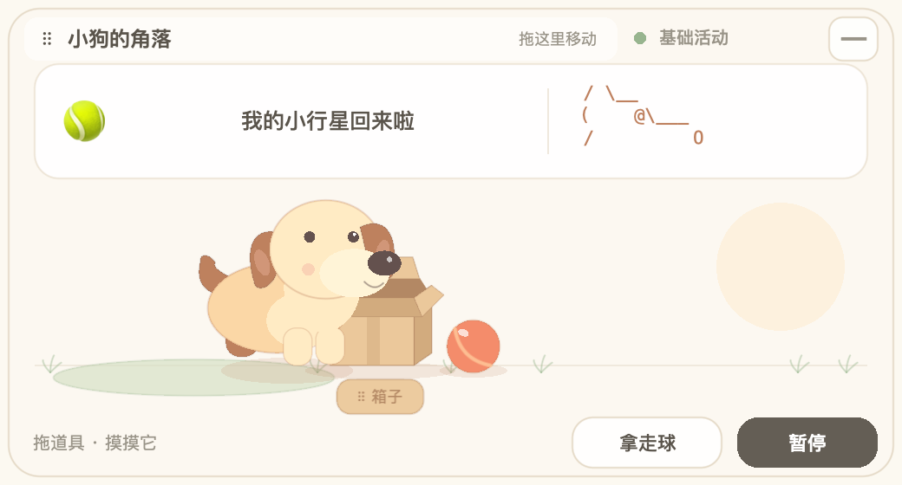

<p align="center">
  <br>
  <sub>Recorded on an M2 and played at 2× speed. Each activity and each line in the bubble was chosen live by the on-device model.</sub>
</p>

<h1 align="center">AI Desktop Pet</h1>

<p align="center">
  <b>A puppy that lives in a small window on your Mac and decides for itself what to do next,<br>using only the language model built into macOS.</b><br>
  No cloud, no API key, no screen reading.
</p>

<p align="center">
  <a href="README.zh-CN.md">简体中文</a> ·
  <a href="#the-idea">The idea</a> ·
  <a href="#how-it-works">How it works</a> ·
  <a href="#what-the-experiments-showed">Experiments</a> ·
  <a href="#build-and-run">Build and run</a>
</p>

> [!NOTE]
> **An experimental prototype, not a finished app.** The core loop works and is tested, but the puppy's world is small and the pet's speech is in Chinese only. I'm sharing it mainly for the idea and for what I learned about small on-device models.

## The idea

Most desktop pets play a handful of fixed animations in a loop. After a day you have seen everything they do.

A real puppy is different. It has its own small agenda, it does something unexpected now and then, and when you take its ball away, what it does next changes.

The question behind this project: **can a small language model that runs on the laptop itself give a pet that kind of randomness and autonomy?** It would not chat with you. It would pick what to do next, based on what is actually in front of it.

macOS 27 ships such a model (Apple's Foundation Models framework, `SystemLanguageModel`). It is small, fast and free to call, and it makes things up easily, so the design is built around that.

## How it works

The rule that holds it together: **the model never invents an action. The program decides what is possible, and the model only chooses.**



- **Legal actions only.** Before each call the program runs every action (look at the ball, push it, carry it, drop it in the box, dig in the box, spin, stretch, rest…) on a copy of the world. Only actions that would succeed right now are offered, as an enum in the model's output schema. If the ball is gone, "push the ball" is simply not on the menu.
- **Short activities.** The model picks up to two actions in a row. After the first pick the program simulates it, so the second choice is made against the world as it will be.
- **Expression is a separate call.** A third call writes a short line and an emoji for the thought bubble. It has no authority over actions, so a confused sentence cannot make the puppy do something illegal. The ASCII doodle is assembled by the program from a subject, an ornament and a mood that the model picks.
- **You can always interrupt.** Dragging a toy, taking the ball, petting or pausing increases a revision number. A plan computed for an older revision is discarded, even if the model answers later.
- **Where the variety comes from.** Partly from the program: it shuffles the candidate order and leaves out actions done recently. Partly from the model: which of the remaining actions it picks, how it pairs them, and what the puppy says.
- **It keeps running when the model can't.** If the system model is unavailable or slow, the puppy falls back to simple programmed activities, and the status label says so.

Calls are rationed: one at a time, at least 12 seconds apart, cancelled after 20 seconds, and backed off for 30 seconds after a failure.

<p align="center">
  
</p>

## What the experiments showed

All runs were on an Apple M2. The raw prompts and model outputs, including the failures, are in [`docs/evidence/`](docs/evidence/).

**Version 0.1: how much freedom can the model handle?** (macOS 27.0, 4,096-token context)

| Setup | Plans that were legal and fully executed |
|---|---|
| Free text | Invented an action that doesn't exist ("Run") |
| Verb + target, 1–3 steps | 6 / 8 |
| Full action list, 1–3 steps | 7 / 12, still ignored preconditions such as "the ball is gone" |
| **Only currently legal actions, one step** | **16 / 16** |

The jump to 16/16 comes from narrowing the menu, not from the model getting better at planning.

**Version 0.2: short activities and expression**

| Setup | Accepted and executed |
|---|---|
| Actions and free-form expression in one call | 15 / 16, but 11 of the 15 lines came out in English, and 5 doodles fell back |
| Complex regex guide on the output | 0 / 4, unsupported by the on-device model |
| Free-form Chinese ASCII art | 2 / 4, with refusals and broken drawings |
| **Actions and expression split into separate calls** | **16 / 16 over a continuous session**, with 15 different action sequences, 16 different lines, 7 doodles and 7 emoji |

In the continuous runs I moved the box, took the ball away and put it back during play, and the puppy adapted each time.

On macOS 27.0 the final version took a median of 8.3 s per activity (16 runs, three calls each). On macOS 27.2 the system model reports an 8,192-token context, and a quick check of 4 activities took 2.6–3.3 s each.

## Known limitations

- **Small world.** One dimension, four objects and fifteen actions, with at most two actions per activity. It does not invent new games.
- **The lines don't always match the actions.** It might say it's going to nap when it's only walking to its mat.
- **Chinese-only speech**, and the interface is in Chinese.
- Not tested for long-term energy use, fully offline operation, or on other Macs and system versions.

## Build and run

**Requirements**
- macOS 27 or later on Apple silicon
- Apple Intelligence turned on in System Settings; without it the pet runs in basic mode
- Xcode 27 (Swift 6.2 toolchain or later)
- No third-party dependencies

```sh
git clone https://github.com/Skyxu-001/ai-desktop-pet.git
cd ai-desktop-pet
./scripts/build-app.sh
open build/LocalDesktopPet.app
```

The window title is 小狗的角落 ("Puppy's Corner"). A paw icon in the menu bar can show or hide the window, switch to a transparent desktop mode, show model status, or quit.

**What you can do**
- Drag the ball or the box: the current activity stops, and the next decision uses the new positions.
- Click the puppy to pet it. It hops, spins or stretches (these reactions are programmed, not chosen by the model).
- Take the ball away or put it back, which changes which actions the model is offered.
- Pause: the puppy stops acting on its own, and you can still arrange the toys.

It does not read the screen, files, keyboard or other apps, asks for no special permissions, and does not start at login. The only thing it saves is a small memory file in `~/Library/Application Support/LocalDesktopPet/`: the last 12 completed activities and how many times you petted it.

## Tests

```sh
swift test                                                    # 70 tests
swift run PetProbe --count 16 --output temp/probe.json        # 16 live model plans in 4 situations
swift run PetProbe --continuous --count 16 --output temp/continuous.json
```

`PetProbe` uses the same model code and executor as the app. `--continuous` carries the world over from one plan to the next, and moves the box, takes the ball and puts it back at rounds 5, 9 and 13.

## Project layout

| Path | What's in it |
|---|---|
| `Sources/PetCore` | The world: positions, action preconditions, simulation, revisions |
| `Sources/PetModel` | Calls to the on-device model; legal-action candidates; doodle assembly |
| `Sources/PetRuntime` | Call rationing (one at a time, cooldown, timeout) and the small memory file |
| `Sources/PetUI` | SpriteKit scene: drawing, hit testing, dragging |
| `Sources/DesktopPet` | The app: window, menu bar, scheduling, petting reactions |
| `Sources/PetProbe` | Command-line runner for live model experiments |

## License

[MIT](LICENSE)
