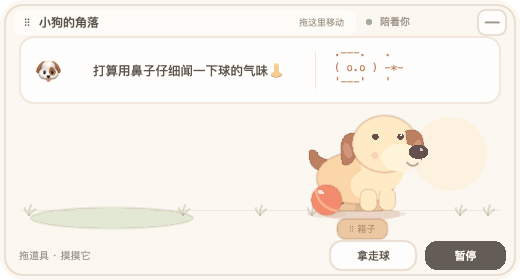
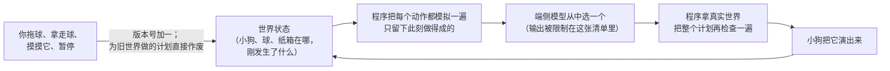
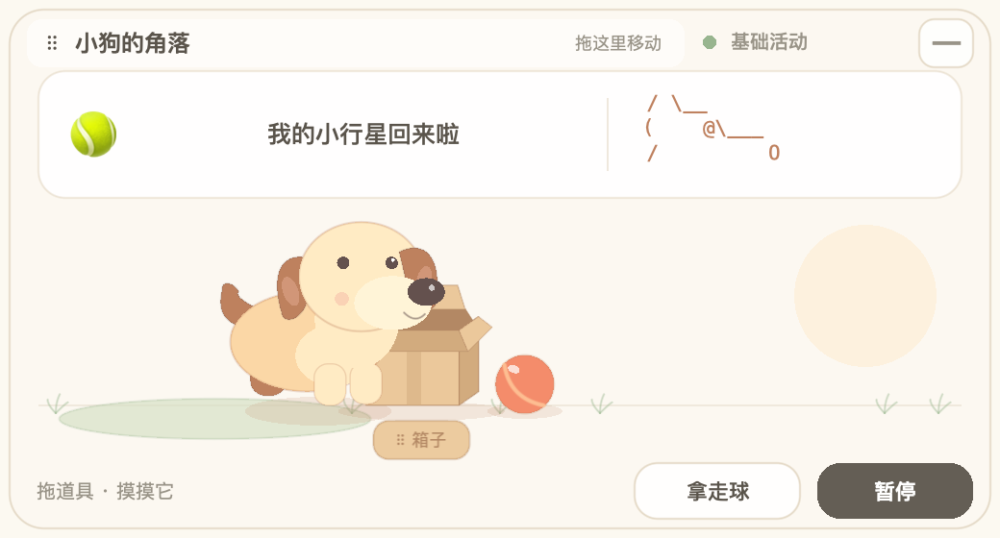

<p align="center">
  <br>
  <sub>在 M2 上实录，2 倍速播放。每个活动和气泡里的每句话，都是端侧模型当场选的。</sub>
</p>

<h1 align="center">AI 桌面宠物</h1>

<p align="center">
  <b>住在 Mac 桌面小窗口里的小狗，自己决定接下来做什么，<br>只用 macOS 自带的端侧语言模型。</b><br>
  不联网、不要 API key、不读屏幕。
</p>

<p align="center">
  <a href="README.md">English</a> ·
  <a href="#点子">点子</a> ·
  <a href="#怎么运作">怎么运作</a> ·
  <a href="#实验结果">实验结果</a> ·
  <a href="#构建和运行">构建和运行</a>
</p>

> [!NOTE]
> **这是实验原型，不是成品。** 核心流程能跑、有测试，但小狗的世界还很小，说话只有中文。放出来主要是分享这个点子，以及我对端侧小模型的一些发现。

## 点子

大多数桌面宠物只会循环播放几段固定动画，看一天就看完了。

真的小狗不一样：它有自己的小打算，时不时做点出人意料的事；你把它的球拿走，它接下来做什么也会跟着变。

这个项目想回答的问题：**一个跑在电脑本地的小语言模型，能不能让宠物有这种随机性和自主能力？** 它不是陪你聊天，而是根据眼前真实的情况，自己决定下一步做什么。

macOS 27 自带这样一个模型（Apple 的 Foundation Models 框架，`SystemLanguageModel`）。它小、快、调用免费，但很容易胡编，所以整个设计都围绕这一点来做。

## 怎么运作

核心规则：**模型永远不能发明动作。程序决定什么是可能的，模型只负责选。**



- **只给合法动作。** 每次调用前，程序在世界的副本上把每个动作（看球、推球、叼球、把球放进箱子、刨箱子、转圈、伸懒腰、休息……）都试一遍，只把此刻做得成的，作为输出格式里的枚举交给模型。球不在场，「推球」就根本不在菜单上。
- **短活动。** 模型最多连选两个动作。选完第一个，程序先模拟执行，第二个是按执行后的世界来选的。
- **说话单独调用一次。** 第三次调用写气泡里的短句和 emoji，它管不了动作，所以一句胡话不可能让小狗做出不合法的事。字符小画由模型选主题、装饰、表情，程序拼出来。
- **随时可以打断。** 拖道具、拿走球、摸它、暂停，都会让版本号加一；给旧版本算出来的计划，就算模型晚点回答了，也直接丢掉。
- **变化从哪来。** 一部分来自程序：打乱候选顺序、剔除最近做过的动作；一部分来自模型：剩下的里面选哪个、怎么搭配、小狗说什么。
- **模型不行的时候也不会停住。** 系统模型不可用或太慢时，小狗换成简单的程序活动，状态标签会写明。

调用有节制：同时只有一个；两次之间至少隔 12 秒；超过 20 秒取消；失败后等 30 秒再试。

<p align="center">
  
</p>

## 实验结果

全部在 Apple M2 上跑。原始提示词和模型输出（包括失败的）都在 [`docs/evidence/`](docs/evidence/)。

**0.1 版：模型能承受多大自由度？**（macOS 27.0，上下文 4096 tokens）

| 设置 | 合法且完整执行的计划 |
|---|---|
| 自由文本 | 编出一个不存在的动作「Run」 |
| 动词 + 目标，1–3 步 | 6 / 8 |
| 完整动作列表，1–3 步 | 7 / 12，仍会忽略「球已经不在了」这类前提 |
| **只给此刻合法的动作，单步** | **16 / 16** |

跳到 16/16 靠的是缩小菜单，不是模型规划能力变强了。

**0.2 版：短活动和表达**

| 设置 | 接纳并执行 |
|---|---|
| 动作和自由表达放在同一次调用 | 15 / 16，但成功的 15 次里有 11 句是英文，5 次字符画回退 |
| 输出加复杂正则约束 | 0 / 4，端侧模型不支持 |
| 让模型自由画中文字符画 | 2 / 4，有拒绝，画也不完整 |
| **动作和表达拆成两次调用** | **连续一局 16 / 16**：15 种动作组合、16 句不同的话、7 种小画、7 种 emoji |

连续实验中途我搬过箱子、拿走过球、又放回去，小狗每次都跟着调整。

在 macOS 27.0 上，最终版每个活动中位数 8.3 秒（16 次，每次三个调用）。到了 macOS 27.2，系统模型报告上下文 8192 tokens，简单测了 4 个活动，每个 2.6–3.3 秒。

## 已知局限

- **世界很小。** 一维、四个物体、十五个动作，每次活动最多两步。不会自己发明新游戏。
- **说的话和做的事不总对得上。** 比如只是走向小毯子，却说要去睡觉。
- **说话只有中文**，界面也是中文。
- 长期耗电、完全断网运行、其他型号的 Mac 和其他系统版本，都没测过。

## 构建和运行

**要求**
- macOS 27 或更新，Apple 芯片
- 系统设置里打开 Apple Intelligence；没开的话小狗只做基础活动
- Xcode 27（Swift 6.2 或更新的工具链）
- 不需要任何第三方依赖

```sh
git clone https://github.com/Skyxu-001/ai-desktop-pet.git
cd ai-desktop-pet
./scripts/build-app.sh
open build/LocalDesktopPet.app
```

窗口标题叫「小狗的角落」。菜单栏的爪印可以显示 / 隐藏窗口、切换透明桌面模式、查看模型状态或退出。

**可以怎么玩**
- 拖球或纸箱：当前活动马上停下，下一次决定按新位置来。
- 点小狗摸摸它：它会跳一下、转圈或伸懒腰（这些反应是程序写的，不是模型选的）。
- 拿走球 / 放回球：会改变模型能选的动作。
- 暂停：小狗不再自己行动，你仍然可以摆放道具。

不读取屏幕、文件、键盘或其他应用，不申请任何特殊权限，不开机自启。唯一保存的是 `~/Library/Application Support/LocalDesktopPet/` 下的一个小记忆文件：最近完成的 12 个活动和被摸的次数。

## 测试

```sh
swift test                                                    # 70 项测试
swift run PetProbe --count 16 --output temp/probe.json        # 4 种情况下真调模型 16 次
swift run PetProbe --continuous --count 16 --output temp/continuous.json
```

`PetProbe` 和应用用的是同一套模型调用和执行器。`--continuous` 会把上一次的世界带到下一次，并在第 5、9、13 轮搬箱子、拿走球、放回球。

## 目录

| 路径 | 内容 |
|---|---|
| `Sources/PetCore` | 世界：位置、动作前提、模拟、版本号 |
| `Sources/PetModel` | 调端侧模型、生成合法动作候选、拼字符小画 |
| `Sources/PetRuntime` | 调用节制（同时一个、冷却、超时）和小记忆文件 |
| `Sources/PetUI` | SpriteKit 场景：绘制、点击判定、拖拽 |
| `Sources/DesktopPet` | 应用本身：窗口、菜单栏、调度、摸摸反应 |
| `Sources/PetProbe` | 跑真模型实验的命令行工具 |

## 许可证

[MIT](LICENSE)
